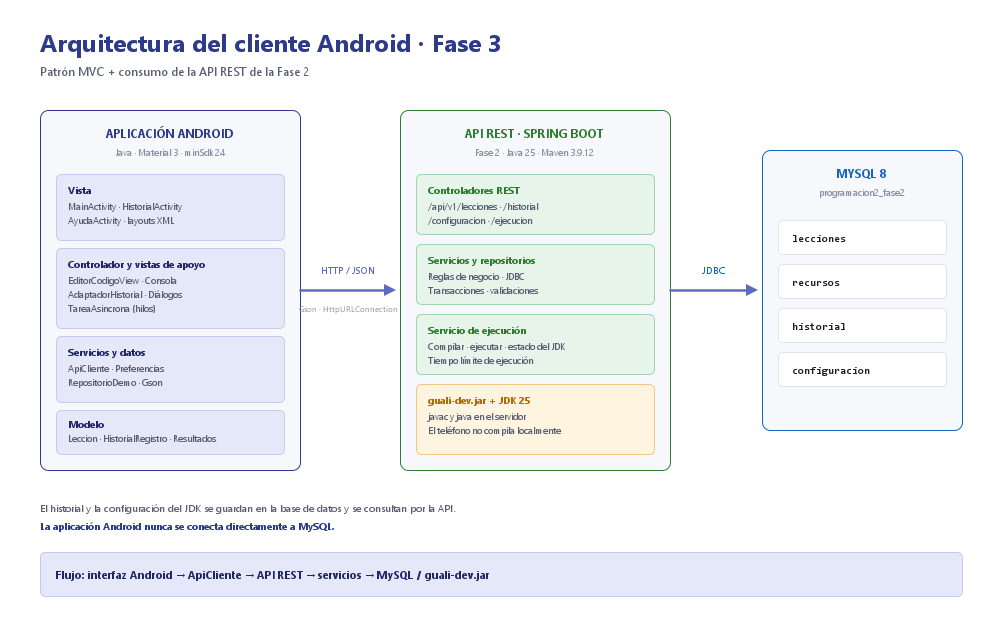
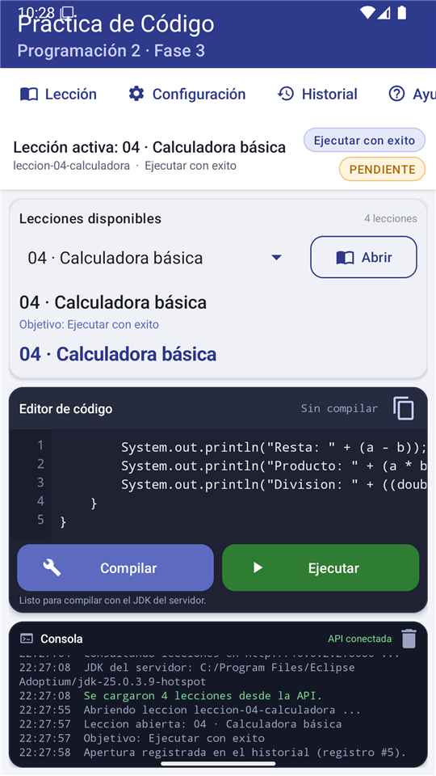
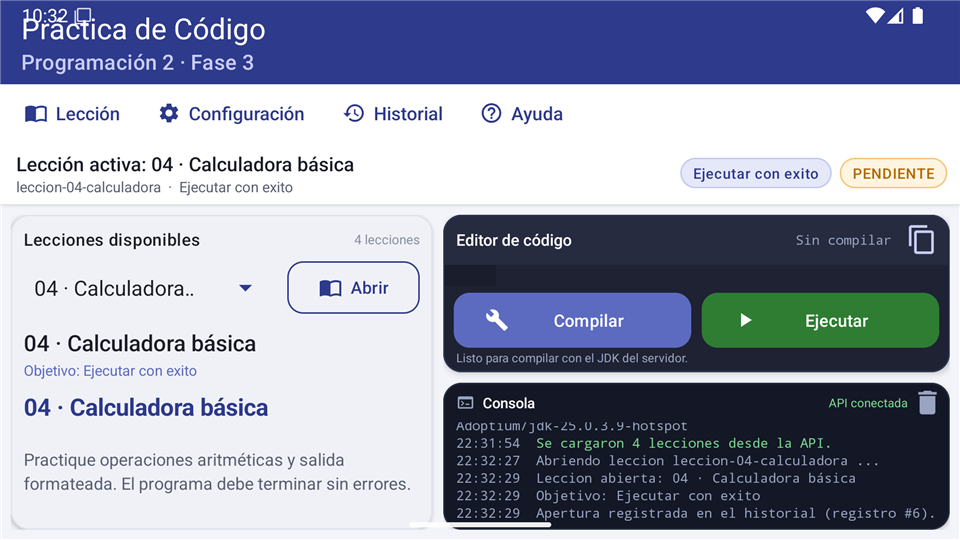
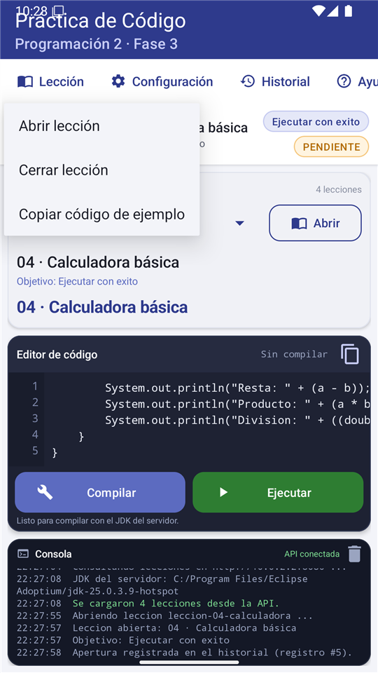
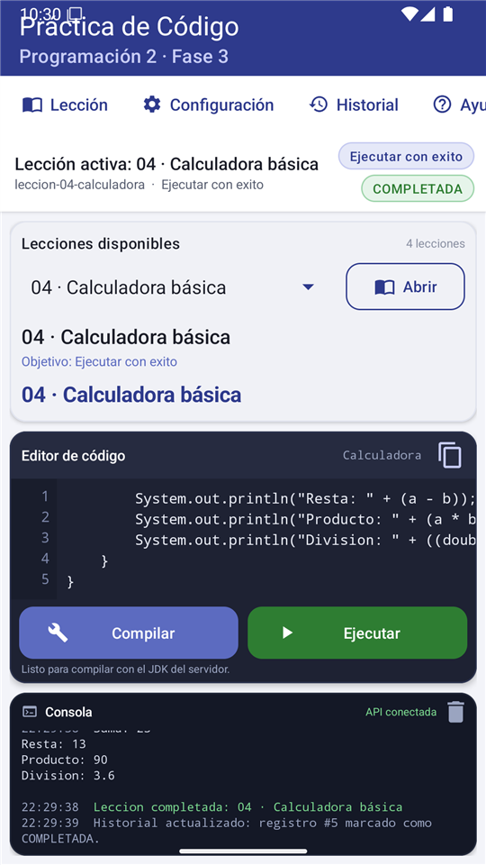
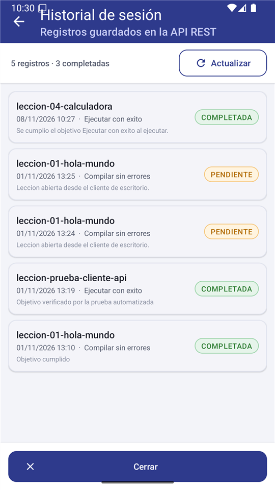
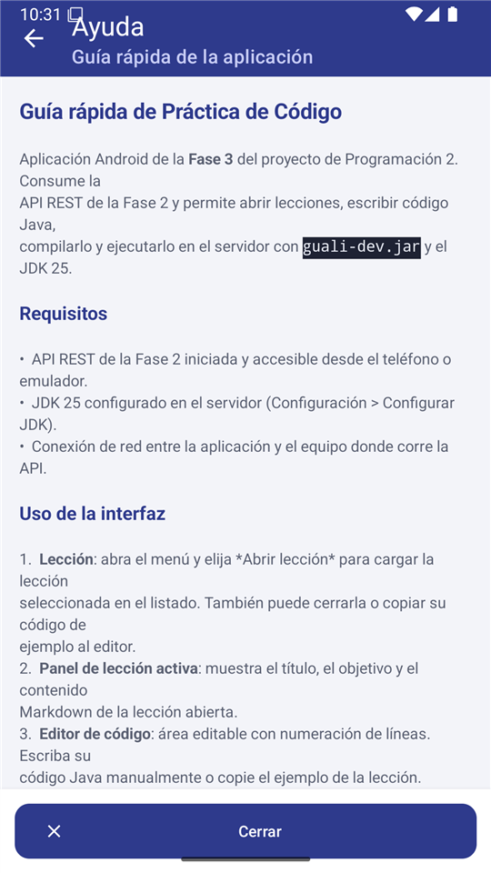
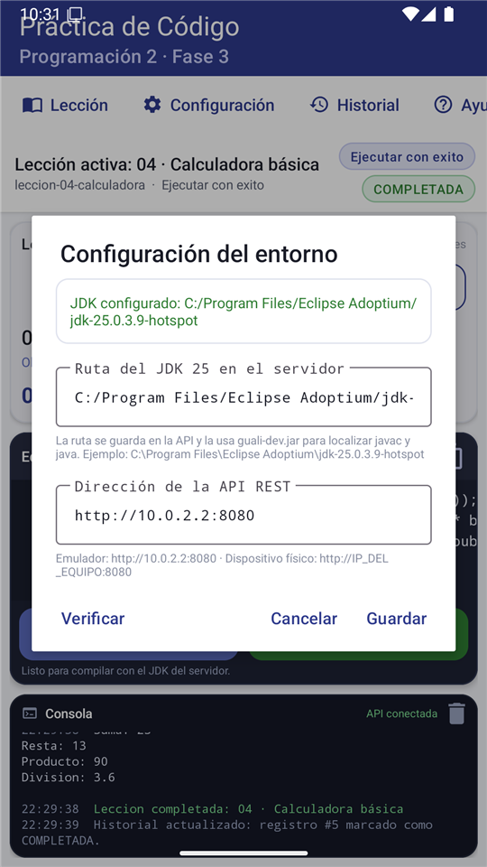

# Tutorial: cliente Android para Práctica de Código (Fase 3)

**Universidad Mariano Gálvez de Guatemala**  
**Curso:** Programación 2  
**Estudiante:** Ashlee Stefani Ordóñez Pérez  
**Carné:** 3190-25-4272  
**Proyecto:** Práctica de Código · Fase 3 (cliente Android)

---

## 1. Presentación

Este tutorial describe, paso a paso y en orden, cómo crear el **front-end Android**
de la aplicación *Práctica de Código*. La aplicación consume la API REST
construida en la Fase 2 y permite:

- Abrir lecciones importadas desde archivos Markdown.
- Leer el objetivo y el contenido de la lección activa.
- Escribir código Java en un editor con numeración de líneas.
- Compilar y ejecutar el código en el servidor con `guali-dev.jar` y el JDK 25.
- Ver la salida de la compilación y de la ejecución en una consola.
- Registrar el historial de lecciones abiertas y completadas.
- Configurar la dirección de la API y la ruta del JDK del servidor.

La interfaz incluye los cinco elementos solicitados: **barra de menú**,
**título de la lección activa**, **panel de la lección activa**, **editor de
código**, **panel de consola** y los botones **Compilar** y **Ejecutar**.

> **Nota sobre las imágenes:** todas las capturas de este tutorial fueron
> tomadas de la aplicación real en un emulador Android 15 (API 35,
> 1080 × 1920), conectada a la API de la Fase 2 en `http://10.0.2.2:8080`.
> Muestran las cuatro lecciones importadas, la compilación con `guali-dev.jar`
> y la ejecución de la clase `Calculadora` en el servidor.

### Arquitectura general



La aplicación aplica el patrón **MVC**:

| Capa | Clases |
|------|--------|
| Vista | `MainActivity`, `HistorialActivity`, `AyudaActivity`, layouts XML, `EditorCodigoView`, `Consola`, `AdaptadorHistorial`, `DialogoConfiguracion` |
| Controlador y servicios | `ApiCliente`, `TareaAsincrona`, `Preferencias`, `RepositorioDemo`, `EvaluadorObjetivos` |
| Modelo | `Leccion`, `LeccionResumen`, `HistorialRegistro`, `ResultadoCompilacion`, `ResultadoEjecucion`, `EstadoJdk`, etc. |

El teléfono **no compila código localmente**: envía el texto a la API de la
Fase 2, que ejecuta `guali-dev.jar` con el JDK 25 instalado en el servidor.

---

## 2. Requisitos previos e instalación del software

### 2.1. Java Development Kit 25

1. Descargue **Eclipse Temurin JDK 25** desde
   <https://adoptium.net/temurin/releases/?version=25>.
2. Ejecute el instalador y habilite la opción *Set JAVA_HOME variable*.
3. Verifique en una terminal:

```powershell
java -version
javac -version
```

Debe mostrarse una versión `25.x`. Si el equipo tiene varias versiones de Java,
configure `JAVA_HOME` con la ruta del JDK 25.

### 2.2. Android Studio

1. Descargue Android Studio desde <https://developer.android.com/studio>.
2. Instale con las opciones por omisión (incluye el SDK de Android).
3. Abra Android Studio y complete el asistente **Setup Wizard**.
4. En **SDK Manager** instale:
   - Android SDK Platform **35** (Android 15).
   - Android SDK Build-Tools 35.x.
   - Android SDK Platform-Tools.
   - Un **Android Emulator** con una imagen del sistema API 35.

### 2.3. Gradle

El proyecto incluye el **Gradle Wrapper** (`gradlew` y `gradlew.bat`), por lo que
no es necesario instalar Gradle aparte. El wrapper descarga Gradle **8.9** la
primera vez que se compila.

### 2.4. API REST de la Fase 2

El cliente necesita el backend de la Fase 2 en ejecución:

```powershell
cd "C:\ruta\al\proyecto\fase-2\backend"
java -jar target\proyecto-fase-2-backend.jar
```

La API queda disponible en `http://localhost:8080`. Verifique con:

```powershell
curl.exe http://localhost:8080/api/v1/salud
```

También debe existir un JDK 25 en el equipo del servidor y su ruta se
configurará más adelante desde la aplicación.

### 2.5. Verificación del entorno

| Herramienta | Versión mínima | Comando |
|-------------|----------------|---------|
| JDK | 25 | `java -version` |
| Android Studio | Estable reciente | Menú *Help > About* |
| Android SDK | 35 | *SDK Manager* |
| Gradle (wrapper) | 8.9 | `gradlew --version` |
| Maven (backend) | 3.9.12 | `mvn -version` |
| MySQL (backend) | 8.0 | `mysql --version` |

---

## 3. Crear el proyecto en Android Studio

1. Abra Android Studio y elija **New Project**.
2. Seleccione la plantilla **Empty Views Activity**.
3. Complete el asistente:

| Campo | Valor |
|-------|-------|
| Name | `PracticaCodigo` |
| Package name | `gt.edu.umg.practicacodigo` |
| Save location | `fase 3/android` |
| Language | **Java** |
| Minimum SDK | **API 24 (Android 7.0)** |
| Build configuration language | Kotlin DSL o Groovy DSL (este proyecto usa **Groovy**) |

4. Presione **Finish** y espere la sincronización de Gradle.

> El proyecto entregado ya está creado. Estos pasos permiten reconstruirlo
> desde cero si fuera necesario.

---

## 4. Estructura del proyecto

```text
android/
├── build.gradle
├── settings.gradle
├── gradle.properties
├── gradlew / gradlew.bat
├── gradle/wrapper/
│   ├── gradle-wrapper.jar
│   └── gradle-wrapper.properties
└── app/
    ├── build.gradle
    ├── proguard-rules.pro
    └── src/
        ├── main/
        │   ├── AndroidManifest.xml
        │   ├── assets/demo/lecciones.json
        │   ├── java/gt/edu/umg/practicacodigo/
        │   │   ├── MainActivity.java
        │   │   ├── HistorialActivity.java
        │   │   ├── AyudaActivity.java
        │   │   ├── api/ApiCliente.java
        │   │   ├── datos/RepositorioDemo.java
        │   │   ├── modelo/…
        │   │   ├── util/…
        │   │   └── vista/…
        │   └── res/
        │       ├── layout/activity_main.xml
        │       ├── layout-land/activity_main.xml
        │       ├── layout/activity_historial.xml
        │       ├── layout/activity_ayuda.xml
        │       ├── layout/dialogo_configuracion.xml
        │       ├── layout/item_historial.xml
        │       ├── drawable/…
        │       ├── mipmap-anydpi-v26/…
        │       ├── raw/ayuda.md
        │       ├── values/…
        │       └── xml/network_security_config.xml
        └── test/java/gt/edu/umg/practicacodigo/util/EvaluadorObjetivosTest.java
```

---

## 5. Configurar Gradle

### 5.1. `settings.gradle`

```gradle
pluginManagement {
    repositories {
        google()
        mavenCentral()
        gradlePluginPortal()
    }
}

dependencyResolutionManagement {
    repositoriesMode.set(RepositoriesMode.FAIL_ON_PROJECT_REPOS)
    repositories {
        google()
        mavenCentral()
    }
}

rootProject.name = "PracticaCodigo"
include ':app'
```

### 5.2. `build.gradle` de la raíz

```gradle
plugins {
    id 'com.android.application' version '8.7.3' apply false
}
```

### 5.3. `app/build.gradle`

```gradle
plugins {
    id 'com.android.application'
}

android {
    namespace 'gt.edu.umg.practicacodigo'
    compileSdk 35

    defaultConfig {
        applicationId "gt.edu.umg.practicacodigo"
        minSdk 24
        targetSdk 35
        versionCode 3
        versionName "3.0"
        testInstrumentationRunner "androidx.test.runner.AndroidJUnitRunner"
    }

    compileOptions {
        sourceCompatibility JavaVersion.VERSION_17
        targetCompatibility JavaVersion.VERSION_17
    }

    buildFeatures {
        buildConfig true
    }
}

dependencies {
    implementation 'androidx.appcompat:appcompat:1.7.0'
    implementation 'com.google.android.material:material:1.12.0'
    implementation 'androidx.constraintlayout:constraintlayout:2.1.4'
    implementation 'androidx.recyclerview:recyclerview:1.3.2'
    implementation 'com.google.code.gson:gson:2.11.0'

    testImplementation 'junit:junit:4.13.2'
}
```

### 5.4. `gradle/wrapper/gradle-wrapper.properties`

```properties
distributionBase=GRADLE_USER_HOME
distributionPath=wrapper/dists
distributionUrl=https\://services.gradle.org/distributions/gradle-8.9-bin.zip
networkTimeout=10000
validateDistributionUrl=true
```

### 5.5. `local.properties`

Android Studio genera este archivo con la ruta del SDK. Si no existe, copie
`local.properties.example` y ajuste la ruta:

```properties
sdk.dir=C\:\\Users\\su_usuario\\AppData\\Local\\Android\\Sdk
```

> `local.properties` no se publica en GitHub porque depende de cada equipo.

---

## 6. Permisos y comunicación HTTP local

### 6.1. `AndroidManifest.xml`

```xml
<manifest xmlns:android="http://schemas.android.com/apk/res/android">

    <uses-permission android:name="android.permission.INTERNET" />
    <uses-permission android:name="android.permission.ACCESS_NETWORK_STATE" />

    <application
        android:allowBackup="true"
        android:icon="@mipmap/ic_launcher"
        android:label="@string/app_name"
        android:networkSecurityConfig="@xml/network_security_config"
        android:roundIcon="@mipmap/ic_launcher_round"
        android:supportsRtl="true"
        android:theme="@style/Theme.PracticaCodigo"
        android:usesCleartextTraffic="true">

        <activity
            android:name=".MainActivity"
            android:exported="true"
            android:windowSoftInputMode="adjustResize">
            <intent-filter>
                <action android:name="android.intent.action.MAIN" />
                <category android:name="android.intent.category.LAUNCHER" />
            </intent-filter>
        </activity>

        <activity
            android:name=".HistorialActivity"
            android:exported="false"
            android:parentActivityName=".MainActivity" />

        <activity
            android:name=".AyudaActivity"
            android:exported="false"
            android:parentActivityName=".MainActivity" />
    </application>
</manifest>
```

### 6.2. `res/xml/network_security_config.xml`

El backend de desarrollo usa HTTP sin cifrar en la red local. Android 9 y
superiores bloquean ese tráfico por omisión, por eso se declara la excepción:

```xml
<network-security-config>
    <base-config cleartextTrafficPermitted="true">
        <trust-anchors>
            <certificates src="system" />
        </trust-anchors>
    </base-config>
</network-security-config>
```

> En producción se debe usar HTTPS y eliminar `usesCleartextTraffic`.

---

## 7. Recursos visuales

### 7.1. Colores (`res/values/colors.xml`)

Se define una paleta azul institucional, colores de estado y colores para el
editor y la consola:

```xml
<resources>
    <color name="primario">#2E3A8C</color>
    <color name="primario_oscuro">#1F2766</color>
    <color name="primario_medio">#5C6BC0</color>
    <color name="primario_claro">#E5E8F8</color>
    <color name="secundario">#F2A33C</color>

    <color name="fondo">#F3F4F9</color>
    <color name="superficie">#FFFFFF</color>
    <color name="borde">#E0E3EE</color>

    <color name="texto_principal">#1B1D28</color>
    <color name="texto_secundario">#5A6072</color>
    <color name="texto_tenue">#8A90A2</color>

    <color name="codigo_fondo">#1E2233</color>
    <color name="codigo_texto">#E6E9F2</color>
    <color name="codigo_numero">#7C86A8</color>

    <color name="consola_fondo">#141826</color>
    <color name="consola_texto">#D7DCEA</color>
    <color name="terminal_exito">#7BD88F</color>
    <color name="terminal_error">#FF8A80</color>
    <color name="terminal_info">#9AA4C0</color>
    <color name="terminal_comando">#FFD180</color>

    <color name="exito">#2E7D32</color>
    <color name="exito_claro">#E6F4EA</color>
    <color name="error">#C62828</color>
    <color name="advertencia">#B26A00</color>
    <color name="advertencia_claro">#FFF4E0</color>
</resources>
```

### 7.2. Tema (`res/values/themes.xml`)

```xml
<style name="Theme.PracticaCodigo" parent="Theme.Material3.Light.NoActionBar">
    <item name="colorPrimary">@color/primario</item>
    <item name="colorOnPrimary">@color/blanco</item>
    <item name="colorPrimaryContainer">@color/primario_claro</item>
    <item name="colorOnPrimaryContainer">@color/primario_oscuro</item>
    <item name="colorSecondary">@color/secundario</item>
    <item name="colorSurface">@color/superficie</item>
    <item name="colorOnSurface">@color/texto_principal</item>
    <item name="android:colorBackground">@color/fondo</item>
    <item name="android:statusBarColor">@color/primario_oscuro</item>
    <item name="android:navigationBarColor">@color/primario_oscuro</item>
</style>
```

También se definen estilos reutilizables para los ítems de la barra de menú,
los chips de estado, los títulos de sección y los botones.

### 7.3. Cadenas de texto

Todas las etiquetas visibles se declaran en `res/values/strings.xml`:

```xml
<string name="app_name">Práctica de Código</string>
<string name="menu_leccion">Lección</string>
<string name="menu_configuracion">Configuración</string>
<string name="menu_historial">Historial</string>
<string name="menu_ayuda">Ayuda</string>
<string name="compilar">Compilar</string>
<string name="ejecutar">Ejecutar</string>
<string name="consola_titulo">Consola</string>
```

---

## 8. Layout de la pantalla principal (vertical)

El layout `res/layout/activity_main.xml` se organiza en cinco franjas
verticales:

1. **Toolbar** con el nombre de la aplicación.
2. **Barra de menú** horizontal con cuatro opciones.
3. **Título de la lección activa** y chips de objetivo/estado.
4. **Panel de la lección activa** (listado, spinner, botón Abrir y contenido).
5. **Editor de código** con los botones Compilar/Ejecutar y **consola** al pie.

Estructura resumida:

```xml
<LinearLayout
    android:layout_width="match_parent"
    android:layout_height="match_parent"
    android:background="@color/fondo"
    android:orientation="vertical">

    <com.google.android.material.appbar.MaterialToolbar
        android:id="@+id/toolbar"
        android:layout_width="match_parent"
        android:layout_height="?attr/actionBarSize"
        android:background="@color/primario"
        app:title="@string/app_name"
        app:subtitle="@string/app_subtitulo"
        app:titleTextColor="@color/blanco"
        app:subtitleTextColor="#C7CCF5" />

    <HorizontalScrollView
        android:layout_width="match_parent"
        android:layout_height="@dimen/altura_barra_menu"
        android:background="@color/superficie"
        android:fillViewport="true"
        android:scrollbars="none">

        <LinearLayout
            android:layout_width="wrap_content"
            android:layout_height="match_parent"
            android:orientation="horizontal">

            <TextView
                android:id="@+id/menuLeccion"
                style="@style/MenuBarraItem"
                android:drawableStart="@drawable/ic_leccion"
                android:text="@string/menu_leccion" />

            <TextView
                android:id="@+id/menuConfiguracion"
                style="@style/MenuBarraItem"
                android:drawableStart="@drawable/ic_configuracion"
                android:text="@string/menu_configuracion" />

            <TextView
                android:id="@+id/menuHistorial"
                style="@style/MenuBarraItem"
                android:drawableStart="@drawable/ic_historial"
                android:text="@string/menu_historial" />

            <TextView
                android:id="@+id/menuAyuda"
                style="@style/MenuBarraItem"
                android:drawableStart="@drawable/ic_ayuda"
                android:text="@string/menu_ayuda" />
        </LinearLayout>
    </HorizontalScrollView>

    <!-- Título de la lección activa -->
    <LinearLayout
        android:layout_width="match_parent"
        android:layout_height="wrap_content"
        android:background="@color/superficie"
        android:orientation="horizontal">

        <LinearLayout
            android:layout_width="0dp"
            android:layout_height="wrap_content"
            android:layout_weight="1"
            android:orientation="vertical">

            <TextView
                android:id="@+id/tituloLeccionActiva"
                android:layout_width="match_parent"
                android:layout_height="wrap_content"
                android:text="@string/titulo_sin_leccion"
                android:textColor="@color/texto_principal"
                android:textSize="15sp" />

            <TextView
                android:id="@+id/subtituloLeccion"
                android:layout_width="match_parent"
                android:layout_height="wrap_content"
                android:text="@string/subtitulo_sin_leccion"
                android:textColor="@color/texto_secundario"
                android:textSize="11sp" />
        </LinearLayout>

        <TextView
            android:id="@+id/chipObjetivo"
            style="@style/ChipEstado"
            android:background="@drawable/bg_chip_objetivo"
            android:text="@string/chip_sin_objetivo" />

        <TextView
            android:id="@+id/chipEstado"
            style="@style/ChipEstado"
            android:background="@drawable/bg_chip_pendiente"
            android:text="@string/chip_pendiente" />
    </LinearLayout>

    <!-- Panel de lección, editor y consola -->
    <LinearLayout
        android:layout_width="match_parent"
        android:layout_height="0dp"
        android:layout_weight="1"
        android:orientation="vertical"
        android:padding="8dp">

        <!-- 1. Panel de la lección activa -->
        <com.google.android.material.card.MaterialCardView
            android:layout_width="match_parent"
            android:layout_height="0dp"
            android:layout_weight="1"
            app:cardBackgroundColor="@color/superficie"
            app:cardCornerRadius="@dimen/radio_tarjeta">

            <LinearLayout
                android:layout_width="match_parent"
                android:layout_height="match_parent"
                android:orientation="vertical"
                android:padding="10dp">

                <Spinner
                    android:id="@+id/spinnerLecciones"
                    android:layout_width="0dp"
                    android:layout_height="44dp"
                    android:layout_weight="1" />

                <com.google.android.material.button.MaterialButton
                    android:id="@+id/botonAbrirLeccion"
                    style="@style/BotonSecundario"
                    android:layout_width="wrap_content"
                    android:layout_height="40dp"
                    android:text="@string/abrir" />

                <TextView
                    android:id="@+id/tituloLeccion"
                    android:layout_width="match_parent"
                    android:layout_height="wrap_content"
                    android:textSize="17sp" />

                <TextView
                    android:id="@+id/objetivoLeccion"
                    android:layout_width="match_parent"
                    android:layout_height="wrap_content"
                    android:textSize="11sp" />

                <ScrollView
                    android:layout_width="match_parent"
                    android:layout_height="0dp"
                    android:layout_weight="1">

                    <TextView
                        android:id="@+id/contenidoLeccion"
                        android:layout_width="match_parent"
                        android:layout_height="wrap_content"
                        android:textSize="13sp" />
                </ScrollView>
            </LinearLayout>
        </com.google.android.material.card.MaterialCardView>

        <!-- 2. Editor de código -->
        <com.google.android.material.card.MaterialCardView
            android:layout_width="match_parent"
            android:layout_height="0dp"
            android:layout_weight="1.25"
            app:cardBackgroundColor="@color/codigo_fondo">

            <LinearLayout
                android:layout_width="match_parent"
                android:layout_height="match_parent"
                android:orientation="vertical">

                <TextView
                    android:id="@+id/nombreClase"
                    android:layout_width="wrap_content"
                    android:layout_height="wrap_content"
                    android:text="@string/sin_compilar" />

                <gt.edu.umg.practicacodigo.vista.EditorCodigoView
                    android:id="@+id/editor"
                    android:layout_width="match_parent"
                    android:layout_height="0dp"
                    android:layout_weight="1" />

                <com.google.android.material.button.MaterialButton
                    android:id="@+id/botonCompilar"
                    style="@style/BotonAccion"
                    android:layout_width="0dp"
                    android:layout_height="44dp"
                    android:layout_weight="1"
                    android:enabled="false"
                    android:text="@string/compilar"
                    app:icon="@drawable/ic_compilar" />

                <com.google.android.material.button.MaterialButton
                    android:id="@+id/botonEjecutar"
                    style="@style/BotonAccion"
                    android:layout_width="0dp"
                    android:layout_height="44dp"
                    android:layout_weight="1"
                    android:enabled="false"
                    android:text="@string/ejecutar"
                    app:icon="@drawable/ic_ejecutar" />

                <TextView
                    android:id="@+id/ayudaJdk"
                    android:layout_width="match_parent"
                    android:layout_height="wrap_content"
                    android:text="@string/ayuda_jdk_inicial" />
            </LinearLayout>
        </com.google.android.material.card.MaterialCardView>

        <!-- 3. Consola -->
        <com.google.android.material.card.MaterialCardView
            android:layout_width="match_parent"
            android:layout_height="@dimen/altura_consola"
            app:cardBackgroundColor="@color/consola_fondo">

            <LinearLayout
                android:layout_width="match_parent"
                android:layout_height="match_parent"
                android:orientation="vertical">

                <TextView
                    android:id="@+id/estadoConexion"
                    android:layout_width="wrap_content"
                    android:layout_height="wrap_content"
                    android:text="@string/estado_conectando" />

                <ScrollView
                    android:layout_width="match_parent"
                    android:layout_height="0dp"
                    android:layout_weight="1">

                    <TextView
                        android:id="@+id/consola"
                        android:layout_width="match_parent"
                        android:layout_height="wrap_content"
                        android:fontFamily="monospace"
                        android:textColor="@color/consola_texto"
                        android:textSize="10sp" />
                </ScrollView>
            </LinearLayout>
        </com.google.android.material.card.MaterialCardView>
    </LinearLayout>
</LinearLayout>
```

> El archivo completo incluye además el contador de lecciones, el botón para
> copiar el código, el botón para limpiar la consola y los íconos.

### Resultado



---

## 9. Layout horizontal (orientación apaisada)

Para aprovechar el espacio en horizontal se crea
`res/layout-land/activity_main.xml`. Mantiene los mismos `id`, de modo que
`MainActivity` funciona sin cambios, pero organiza el contenido en dos
columnas:

- **Columna izquierda:** panel de la lección activa.
- **Columna derecha:** editor de código y consola.

```xml
<LinearLayout
    android:layout_width="match_parent"
    android:layout_height="0dp"
    android:layout_weight="1"
    android:orientation="horizontal"
    android:padding="8dp">

    <com.google.android.material.card.MaterialCardView
        android:layout_width="0dp"
        android:layout_height="match_parent"
        android:layout_weight="1"
        android:layout_marginEnd="8dp">
        <!-- Panel de la lección activa -->
    </com.google.android.material.card.MaterialCardView>

    <LinearLayout
        android:layout_width="0dp"
        android:layout_height="match_parent"
        android:layout_weight="1.2"
        android:orientation="vertical">

        <com.google.android.material.card.MaterialCardView
            android:layout_width="match_parent"
            android:layout_height="0dp"
            android:layout_weight="1">
            <!-- Editor de código -->
        </com.google.android.material.card.MaterialCardView>

        <com.google.android.material.card.MaterialCardView
            android:layout_width="match_parent"
            android:layout_height="112dp">
            <!-- Consola -->
        </com.google.android.material.card.MaterialCardView>
    </LinearLayout>
</LinearLayout>
```



---

## 10. Modelo de datos

Los modelos son clases Java simples (POJO) que Gson convierte desde el JSON de
la API. Los nombres de los campos coinciden con el contrato OpenAPI de la
Fase 2.

### 10.1. `LeccionResumen`

```java
public class LeccionResumen {
    private long id;
    private String nombre;
    private String titulo;
    private ObjetivoLeccion objetivo;
    private String rutaOrigen;
    private String fechaImportacion;

    public String getTituloVisible() {
        if (titulo != null && !titulo.trim().isEmpty()) {
            return titulo;
        }
        return nombre == null ? "Leccion sin titulo" : nombre;
    }

    @Override
    public String toString() {
        return getTituloVisible();
    }
}
```

### 10.2. `Leccion`

```java
public class Leccion extends LeccionResumen {
    private String contenidoMd;
    private List<RecursoLeccion> recursos = new ArrayList<>();

    public String getContenidoMd() { return contenidoMd; }
    public List<RecursoLeccion> getRecursos() {
        return recursos == null ? new ArrayList<>() : recursos;
    }
}
```

### 10.3. Enumeraciones

```java
public enum ObjetivoLeccion {
    COMPILAR_CON_ERROR("Compilar con error"),
    COMPILAR_EXITOSO("Compilar sin errores"),
    EJECUTAR_CON_ERROR("Ejecutar con error"),
    EJECUTAR_EXITOSO("Ejecutar con exito");

    private final String etiqueta;
    ObjetivoLeccion(String etiqueta) { this.etiqueta = etiqueta; }
    public String getEtiqueta() { return etiqueta; }
}
```

```java
public enum EstadoLeccion {
    COMPLETADA("Completada"),
    PENDIENTE("Pendiente");
    // ...
}
```

### 10.4. Resultados del servidor

```java
public class ResultadoCompilacion {
    private boolean exitoso;
    private String salida;
    private String nombreClase;
    // getters y setters
}

public class ResultadoEjecucion {
    private boolean exitoso;
    private String salida;
    private String errores;
    private boolean timeout;
    // getters y setters
}
```

---

## 11. Cliente de la API REST

`ApiCliente` usa `HttpURLConnection` y Gson. Todos los métodos son síncronos;
la actividad los ejecuta en un hilo secundario.

```java
public class ApiCliente {

    private static final int TIMEOUT_CONEXION = 10000;
    private static final int TIMEOUT_CORTO = 20000;
    private static final int TIMEOUT_COMPILAR = 150000;
    private static final int TIMEOUT_EJECUTAR = 90000;

    private final Gson gson = new GsonBuilder().create();
    private final String baseUrl;

    public ApiCliente(String baseUrl) {
        this.baseUrl = normalizar(baseUrl);
    }

    public List<LeccionResumen> listarLecciones() throws ApiExcepcion {
        Type tipo = new TypeToken<List<LeccionResumen>>() {}.getType();
        return enviar("GET", "/api/v1/lecciones", null, TIMEOUT_CORTO, tipo);
    }

    public Leccion obtenerLeccion(long id) throws ApiExcepcion {
        return enviar("GET", "/api/v1/lecciones/" + id, null, TIMEOUT_CORTO, Leccion.class);
    }

    public List<HistorialRegistro> listarHistorial() throws ApiExcepcion {
        Type tipo = new TypeToken<List<HistorialRegistro>>() {}.getType();
        return enviar("GET", "/api/v1/historial", null, TIMEOUT_CORTO, tipo);
    }

    public HistorialRegistro registrarHistorial(Long leccionId, String leccionNombre,
                                                ObjetivoLeccion objetivo) throws ApiExcepcion {
        SolicitudHistorial cuerpo =
                new SolicitudHistorial(leccionId, leccionNombre, objetivo, null);
        return enviar("POST", "/api/v1/historial", gson.toJson(cuerpo),
                TIMEOUT_CORTO, HistorialRegistro.class);
    }

    public HistorialRegistro marcarCompletada(long id, String detalle) throws ApiExcepcion {
        ActualizacionHistorial cuerpo =
                new ActualizacionHistorial(EstadoLeccion.COMPLETADA, detalle);
        return enviar("PATCH", "/api/v1/historial/" + id, gson.toJson(cuerpo),
                TIMEOUT_CORTO, HistorialRegistro.class);
    }

    public EstadoJdk estadoJdk() throws ApiExcepcion {
        return enviar("GET", "/api/v1/ejecucion/jdk", null, TIMEOUT_CORTO, EstadoJdk.class);
    }

    public EstadoJdk guardarRutaJdk(String ruta) throws ApiExcepcion {
        enviar("PUT", "/api/v1/configuracion/jdk.ruta",
                gson.toJson(new ValorConfiguracion(ruta)), TIMEOUT_CORTO, Object.class);
        return estadoJdk();
    }

    public ResultadoCompilacion compilar(String codigo) throws ApiExcepcion {
        return enviar("POST", "/api/v1/ejecucion/compilar",
                gson.toJson(new SolicitudCompilacion(codigo)),
                TIMEOUT_COMPILAR, ResultadoCompilacion.class);
    }

    public ResultadoEjecucion ejecutar(String nombreClase, int timeoutSegundos)
            throws ApiExcepcion {
        return enviar("POST", "/api/v1/ejecucion/ejecutar",
                gson.toJson(new SolicitudEjecucion(nombreClase, timeoutSegundos)),
                TIMEOUT_EJECUTAR, ResultadoEjecucion.class);
    }
}
```

El método `enviar` configura los encabezados, escribe el cuerpo JSON, lee la
respuesta y convierte los errores HTTP en `ApiExcepcion`:

```java
private <T> T enviar(String metodo, String ruta, String cuerpo,
                     int timeoutLectura, Type tipo) throws ApiExcepcion {
    HttpURLConnection conexion = null;
    try {
        URL url = new URL(baseUrl + ruta);
        conexion = (HttpURLConnection) url.openConnection();
        conexion.setRequestMethod(metodo);
        conexion.setConnectTimeout(TIMEOUT_CONEXION);
        conexion.setReadTimeout(timeoutLectura);
        conexion.setRequestProperty("Accept", "application/json");
        conexion.setUseCaches(false);

        if (cuerpo != null) {
            byte[] datos = cuerpo.getBytes(StandardCharsets.UTF_8);
            conexion.setDoOutput(true);
            conexion.setRequestProperty("Content-Type",
                    "application/json; charset=UTF-8");
            conexion.setFixedLengthStreamingMode(datos.length);
            try (OutputStream salida = conexion.getOutputStream()) {
                salida.write(datos);
            }
        }

        int estado = conexion.getResponseCode();
        boolean correcto = estado >= 200 && estado < 300;
        String texto = leer(correcto
                ? conexion.getInputStream() : conexion.getErrorStream());

        if (!correcto) {
            throw new ApiExcepcion(estado, mensajeDeError(texto, estado));
        }
        if (tipo == null || texto == null || texto.trim().isEmpty()) {
            return null;
        }
        return gson.fromJson(texto, tipo);
    } catch (IOException e) {
        throw new ApiExcepcion(0,
                "No se pudo conectar con " + baseUrl + ".", e);
    } finally {
        if (conexion != null) {
            conexion.disconnect();
        }
    }
}
```

### Direcciones de la API

| Entorno | Dirección |
|---------|-----------|
| Emulador de Android | `http://10.0.2.2:8080` |
| Dispositivo físico en la misma red | `http://IP_DEL_EQUIPO:8080` |

`10.0.2.2` es la dirección especial con la que el emulador ve al equipo
anfitrión. `localhost` dentro del emulador apunta al propio emulador.

---

## 12. Preferencias y tareas asíncronas

### 12.1. `Preferencias`

Guarda la dirección de la API en `SharedPreferences`:

```java
public class Preferencias {

    public static final String API_POR_OMISION = "http://10.0.2.2:8080";
    private static final String ARCHIVO = "practica_codigo";
    private static final String CLAVE_API = "api_url";

    private final SharedPreferences datos;

    public Preferencias(Context contexto) {
        this.datos = contexto.getSharedPreferences(ARCHIVO, Context.MODE_PRIVATE);
    }

    public String getApiUrl() {
        String url = datos.getString(CLAVE_API, API_POR_OMISION);
        return url == null || url.trim().isEmpty() ? API_POR_OMISION : url.trim();
    }

    public void setApiUrl(String url) {
        datos.edit().putString(CLAVE_API, url == null ? API_POR_OMISION : url.trim())
                .apply();
    }
}
```

### 12.2. `TareaAsincrona`

Android no permite hacer HTTP en el hilo principal. Esta clase usa un
`ExecutorService` y un `Handler` del hilo principal:

```java
public class TareaAsincrona {

    public interface Tarea<T> { T ejecutar() throws Exception; }

    public interface Resultado<T> {
        void exito(T valor);
        void error(Exception e);
    }

    private final ExecutorService ejecutor = Executors.newSingleThreadExecutor();
    private final Handler principal = new Handler(Looper.getMainLooper());

    public <T> void ejecutar(final Tarea<T> tarea, final Resultado<T> resultado) {
        ejecutor.execute(() -> {
            try {
                final T valor = tarea.ejecutar();
                principal.post(() -> resultado.exito(valor));
            } catch (final Exception e) {
                principal.post(() -> resultado.error(e));
            }
        });
    }

    public void shutdown() {
        ejecutor.shutdownNow();
    }
}
```

---

## 13. Editor de código con numeración de líneas

`EditorCodigoView` extiende `LinearLayout` y combina:

- un `TextView` con los números de línea,
- un `HorizontalScrollView`,
- un `EditText` monoespaciado que permite desplazamiento horizontal.

```java
public class EditorCodigoView extends LinearLayout {

    private TextView numeros;
    private EditText editor;
    private HorizontalScrollView desplazamiento;

    private void inicializar(Context contexto) {
        setOrientation(HORIZONTAL);
        setBackgroundColor(ContextCompat.getColor(contexto, R.color.codigo_fondo));

        numeros = new TextView(contexto);
        numeros.setTextColor(ContextCompat.getColor(contexto, R.color.codigo_numero));
        numeros.setTypeface(Typeface.MONOSPACE);
        numeros.setGravity(Gravity.TOP | Gravity.END);
        numeros.setLineSpacing(0f, 1.25f);
        addView(numeros, new LayoutParams(dp(40), LayoutParams.MATCH_PARENT));

        desplazamiento = new HorizontalScrollView(contexto);
        desplazamiento.setFillViewport(true);
        addView(desplazamiento, new LayoutParams(0, LayoutParams.MATCH_PARENT, 1f));

        editor = new EditText(contexto);
        editor.setBackgroundColor(Color.TRANSPARENT);
        editor.setTextColor(ContextCompat.getColor(contexto, R.color.codigo_texto));
        editor.setTypeface(Typeface.MONOSPACE);
        editor.setLineSpacing(0f, 1.25f);
        editor.setInputType(InputType.TYPE_CLASS_TEXT
                | InputType.TYPE_TEXT_FLAG_MULTI_LINE
                | InputType.TYPE_TEXT_FLAG_NO_SUGGESTIONS);
        editor.setHorizontallyScrolling(true);
        desplazamiento.addView(editor,
                new LayoutParams(LayoutParams.WRAP_CONTENT, LayoutParams.MATCH_PARENT));

        editor.addTextChangedListener(new TextWatcher() {
            @Override public void beforeTextChanged(CharSequence s, int i, int c, int a) { }
            @Override public void onTextChanged(CharSequence s, int i, int b, int c) { }
            @Override public void afterTextChanged(Editable s) {
                actualizarNumeros();
                if (alCambiarCodigo != null) {
                    alCambiarCodigo.run();
                }
            }
        });

        editor.setOnScrollChangeListener((v, x, y, anteriorX, anteriorY) ->
                numeros.scrollTo(0, y));
    }

    public void setCodigo(String codigo) {
        editor.setText(codigo == null ? "" : codigo);
    }

    public String getCodigo() {
        return editor.getText() == null ? "" : editor.getText().toString();
    }
}
```

La numeración se actualiza contando los saltos de línea:

```java
private void actualizarNumeros() {
    String texto = editor.getText() == null ? "" : editor.getText().toString();
    int total = texto.split("\n", -1).length;
    StringBuilder lineas = new StringBuilder();
    for (int i = 1; i <= total; i++) {
        if (i > 1) lineas.append('\n');
        lineas.append(i);
    }
    numeros.setText(lineas.toString());
}
```

---

## 14. Consola de salida

`Consola` agrega líneas con hora y color según el tipo de mensaje. Se apoya en
`SpannableStringBuilder` para colorear cada línea:

```java
public class Consola {

    private final TextView vista;

    public void info(String mensaje)    { agregar(mensaje, colorInfo); }
    public void exito(String mensaje)   { agregar(mensaje, colorExito); }
    public void error(String mensaje)   { agregar(mensaje, colorError); }
    public void comando(String mensaje) { agregar("$ " + mensaje, colorComando); }

    public void salida(String mensaje) {
        if (mensaje == null || mensaje.trim().isEmpty()) return;
        agregar(mensaje, colorSalida);
    }

    private void agregar(String mensaje, int color) {
        SpannableStringBuilder linea = new SpannableStringBuilder();
        linea.append(hora.format(new Date())).append("  ").append(mensaje);
        linea.setSpan(new ForegroundColorSpan(colorInfo), 0, 8,
                Spanned.SPAN_EXCLUSIVE_EXCLUSIVE);
        linea.setSpan(new ForegroundColorSpan(color), 8, linea.length(),
                Spanned.SPAN_EXCLUSIVE_EXCLUSIVE);

        if (vista.length() > 0) vista.append("\n");
        vista.append(linea);
        desplazarAlFinal();
    }
}
```

---

## 15. Lógica principal (`MainActivity`)

`MainActivity` enlaza las vistas con `findViewById`, configura los menús
emergentes y controla el ciclo de una lección.

### 15.1. Menús

La barra de menú se implementa con cuatro `TextView` que abren `PopupMenu`:

```java
menuLeccion.setOnClickListener(v -> {
    PopupMenu popup = new PopupMenu(MainActivity.this, v);
    popup.getMenu().add(Menu.NONE, 1, 1, R.string.menu_abrir_leccion);
    popup.getMenu().add(Menu.NONE, 2, 2, R.string.menu_cerrar_leccion);
    popup.getMenu().add(Menu.NONE, 3, 3, R.string.menu_copiar_codigo);
    popup.setOnMenuItemClickListener(item -> {
        switch (item.getItemId()) {
            case 1: abrirLeccionSeleccionada(); return true;
            case 2: cerrarLeccion(); return true;
            case 3: copiarCodigoAlEditor(); return true;
            default: return false;
        }
    });
    popup.show();
});
```



### 15.2. Abrir una lección

```java
private void abrirLeccionSeleccionada() {
    final LeccionResumen resumen = leccionSeleccionada();
    if (resumen == null) {
        aviso(getString(R.string.error_sin_leccion));
        return;
    }

    tareas.ejecutar(() -> api.obtenerLeccion(resumen.getId()),
            new TareaAsincrona.Resultado<Leccion>() {
                @Override
                public void exito(Leccion leccion) {
                    mostrarLeccion(leccion);
                    registrarApertura(leccion);
                }

                @Override
                public void error(Exception e) {
                    consola.error("No se pudo abrir la leccion: " + e.getMessage());
                }
            });
}
```

`mostrarLeccion` actualiza el título, el objetivo, el contenido Markdown y el
editor. El código de ejemplo se extrae del primer bloque ```` ```java ```` del
Markdown con `MarcadorMarkdown.extraerBloqueJava`:

```java
private void mostrarLeccion(Leccion leccion) {
    leccionActiva = leccion;
    leccionCompletada = false;
    compilacionVigente = false;
    nombreClaseCompilada = null;
    registroId = -1;

    String titulo = leccion.getTituloVisible();
    String objetivo = ObjetivoLeccion.etiquetaSegura(leccion.getObjetivo());

    tituloLeccionActiva.setText(getString(R.string.leccion_activa_etiqueta, titulo));
    subtituloLeccion.setText(leccion.getNombre() + "  ·  " + objetivo);
    chipObjetivo.setText(objetivo);
    chipEstado.setText(R.string.chip_pendiente);

    tituloLeccion.setText(titulo);
    objetivoLeccion.setText(getString(R.string.objetivo_etiqueta, objetivo));
    contenidoLeccion.setText(
            MarcadorMarkdown.renderizar(this, leccion.getContenidoMd()));

    String codigo = MarcadorMarkdown.extraerBloqueJava(leccion.getContenidoMd());
    editor.setCodigo(codigo.isEmpty() ? MarcadorMarkdown.plantilla() : codigo);
    actualizarBotones();
}
```

### 15.3. Registrar la apertura en el historial

```java
private void registrarApertura(final Leccion leccion) {
    if (leccion.getObjetivo() == null) return;

    tareas.ejecutar(
        () -> api.registrarHistorial(leccion.getId(), leccion.getNombre(),
                leccion.getObjetivo()),
        new TareaAsincrona.Resultado<HistorialRegistro>() {
            @Override
            public void exito(HistorialRegistro registro) {
                registroId = registro.getId();
                consola.info("Apertura registrada (registro #" + registroId + ").");
            }

            @Override
            public void error(Exception e) {
                consola.error("No se pudo registrar la apertura: " + e.getMessage());
            }
        });
}
```

### 15.4. Compilar

Antes de compilar se valida que haya una lección abierta, que no estemos en
modo demostración, que el JDK esté configurado y que el editor tenga código.

```java
private void compilar() {
    if (!validarCompilacion()) return;

    final String codigo = editor.getCodigo();
    consola.comando("compilar");
    botonCompilar.setEnabled(false);
    botonEjecutar.setEnabled(false);

    tareas.ejecutar(() -> api.compilar(codigo),
            new TareaAsincrona.Resultado<ResultadoCompilacion>() {
                @Override
                public void exito(ResultadoCompilacion resultado) {
                    aplicarCompilacion(resultado);
                }

                @Override
                public void error(Exception e) {
                    compilacionVigente = false;
                    consola.error("No se pudo compilar: " + e.getMessage());
                    actualizarBotones();
                }
            });
}

private void aplicarCompilacion(ResultadoCompilacion resultado) {
    if (resultado.isExitoso()) {
        compilacionVigente = true;
        nombreClaseCompilada = resultado.getNombreClase();
        consola.exito("Compilacion exitosa. Clase generada: "
                + resultado.getNombreClase() + ".");
        nombreClase.setText(resultado.getNombreClase());
        consola.salida(resultado.getSalida());
        evaluarCompilacion(true);
    } else {
        compilacionVigente = false;
        nombreClaseCompilada = null;
        consola.error("La compilacion reporto errores.");
        consola.salida(resultado.getSalida());
        evaluarCompilacion(false);
    }
    actualizarBotones();
}
```


### 15.5. Ejecutar

El botón Ejecutar solo se habilita si la compilación más reciente fue
correcta. Si el estudiante modifica el código, se invalida la compilación:

```java
editor.setAlCambiarCodigo(() -> {
    if (compilacionVigente) {
        compilacionVigente = false;
        nombreClaseCompilada = null;
        nombreClase.setText(R.string.sin_compilar);
        consola.info("El codigo cambio. Compile de nuevo antes de ejecutar.");
        actualizarBotones();
    }
});
```

```java
private void ejecutar() {
    if (!compilacionVigente || nombreClaseCompilada == null) {
        aviso(getString(R.string.error_compilar_primero));
        return;
    }

    consola.comando("java " + nombreClaseCompilada);
    tareas.ejecutar(() -> api.ejecutar(nombreClaseCompilada, 10),
            new TareaAsincrona.Resultado<ResultadoEjecucion>() {
                @Override
                public void exito(ResultadoEjecucion resultado) {
                    aplicarEjecucion(resultado);
                }

                @Override
                public void error(Exception e) {
                    consola.error("No se pudo ejecutar: " + e.getMessage());
                    actualizarBotones();
                }
            });
}
```



### 15.6. Evaluar el objetivo de la lección

Al cumplirse el objetivo, la lección se marca **COMPLETADA** y se actualiza el
registro del historial:

```java
private void evaluarCompilacion(boolean exitoso) {
    if (leccionCompletada || leccionActiva == null) return;

    if (EvaluadorObjetivos.cumpleAlCompilar(
            leccionActiva.getObjetivo(), exitoso)) {
        completarLeccion("Se cumplio el objetivo "
                + ObjetivoLeccion.etiquetaSegura(leccionActiva.getObjetivo())
                + " al compilar.");
    }
}

private void evaluarEjecucion(ResultadoEjecucion resultado) {
    if (leccionCompletada || leccionActiva == null) return;

    if (EvaluadorObjetivos.cumpleAlEjecutar(
            leccionActiva.getObjetivo(),
            resultado.isExitoso(), resultado.isTimeout())) {
        completarLeccion("Se cumplio el objetivo "
                + ObjetivoLeccion.etiquetaSegura(leccionActiva.getObjetivo())
                + " al ejecutar.");
    }
}
```

`EvaluadorObjetivos` es una clase sin dependencias de Android, lo que permite
probarla con JUnit:

```java
public static boolean cumpleAlCompilar(ObjetivoLeccion objetivo, boolean exitoso) {
    if (objetivo == null) return false;
    switch (objetivo) {
        case COMPILAR_CON_ERROR: return !exitoso;
        case COMPILAR_EXITOSO:   return exitoso;
        default:                 return false;
    }
}

public static boolean cumpleAlEjecutar(ObjetivoLeccion objetivo,
                                       boolean exitoso, boolean timeout) {
    if (objetivo == null) return false;
    switch (objetivo) {
        case EJECUTAR_CON_ERROR: return timeout || !exitoso;
        case EJECUTAR_EXITOSO:   return exitoso && !timeout;
        default:                 return false;
    }
}
```

---

## 16. Historial de sesión

### 16.1. Layout

`activity_historial.xml` contiene un `RecyclerView`, un texto para el estado
vacío, un indicador de progreso y los botones Actualizar/Cerrar.

`item_historial.xml` representa cada fila: nombre de la lección, fecha de
apertura, objetivo, detalle y un chip de estado.

### 16.2. Adaptador

```java
public class AdaptadorHistorial
        extends RecyclerView.Adapter<AdaptadorHistorial.Titular> {

    private final List<HistorialRegistro> registros = new ArrayList<>();

    public void setRegistros(List<HistorialRegistro> nuevos) {
        registros.clear();
        if (nuevos != null) registros.addAll(nuevos);
        notifyDataSetChanged();
    }

    @Override
    public void onBindViewHolder(@NonNull Titular titular, int posicion) {
        HistorialRegistro registro = registros.get(posicion);
        titular.leccion.setText(registro.getLeccionNombre());
        titular.apertura.setText(Formato.fechaHora(registro.getApertura())
                + "  ·  " + ObjetivoLeccion.etiquetaSegura(registro.getObjetivo()));
        titular.detalle.setText(registro.getDetalle());

        if (registro.estaCompletada()) {
            titular.estado.setText(R.string.chip_completada);
            titular.estado.setBackgroundResource(R.drawable.bg_chip_completada);
            titular.estado.setTextColor(ContextCompat.getColor(
                    titular.itemView.getContext(), R.color.exito));
        } else {
            titular.estado.setText(R.string.chip_pendiente);
            titular.estado.setBackgroundResource(R.drawable.bg_chip_pendiente);
            titular.estado.setTextColor(ContextCompat.getColor(
                    titular.itemView.getContext(), R.color.advertencia));
        }
    }
}
```

### 16.3. Pantalla

`HistorialActivity` consulta `GET /api/v1/historial`, ordena los registros por
fecha descendente y muestra el resumen «N registros · M completadas».



---

## 17. Pantalla de ayuda

`AyudaActivity` lee el archivo `res/raw/ayuda.md` y lo muestra con el mismo
renderizador Markdown de las lecciones:

```java
TextView contenido = findViewById(R.id.contenidoAyuda);
contenido.setText(MarcadorMarkdown.renderizar(this, leerAyuda()));
```

El archivo `res/raw/ayuda.md` contiene los requisitos, el uso de la interfaz,
los objetivos, la configuración y la solución de problemas.



---

## 18. Configuración del JDK y de la API

El diálogo `DialogoConfiguracion` permite:

- consultar el estado del JDK del servidor (`GET /api/v1/ejecucion/jdk`);
- guardar la ruta del JDK 25 (`PUT /api/v1/configuracion/jdk.ruta`);
- cambiar la dirección de la API en `SharedPreferences`.

```java
tareas.ejecutar(() -> ruta.isEmpty()
                ? nuevo.estadoJdk()
                : nuevo.guardarRutaJdk(ruta),
        new TareaAsincrona.Resultado<EstadoJdk>() {
            @Override
            public void exito(EstadoJdk estado) {
                if (estado != null && estado.isConfigurado()) {
                    estadoJdk.setText(getString(R.string.jdk_configurado,
                            estado.getRuta()));
                    alGuardar.alGuardar(estado, url);
                    dialogo.dismiss();
                }
            }

            @Override
            public void error(Exception e) {
                mostrarMensaje(mensaje,
                        "No se pudo guardar la configuracion: " + e.getMessage());
            }
        });
```

> El teléfono no puede explorar el sistema de archivos del servidor, por eso la
> ruta del JDK se escribe manualmente. Ejemplo:
> `C:\Program Files\Eclipse Adoptium\jdk-25.0.3.9-hotspot`.



---

## 19. Modo demostración sin conexión

Si la API no responde, la aplicación carga un catálogo local desde
`assets/demo/lecciones.json` para que la interfaz pueda recorrerse sin
servidor:

```java
private void activarModoDemo(Exception causa) {
    modoDemo = true;
    catalogoDemo.clear();
    catalogoDemo.addAll(RepositorioDemo.cargar(this));
    lecciones.clear();
    lecciones.addAll(catalogoDemo);

    estadoConexion.setText(R.string.sin_conexion_demo);
    consola.error("No se pudo conectar con la API: " + causa.getMessage());
    consola.info(getString(R.string.aviso_demo));
    actualizarBotones();
}
```

En modo demostración los botones **Compilar** y **Ejecutar** permanecen
deshabilitados: la compilación siempre requiere el servidor.

El catálogo incluye cuatro lecciones de ejemplo:

| Lección | Objetivo |
|---------|----------|
| `leccion-01-hola-mundo` | `COMPILAR_EXITOSO` |
| `leccion-02-errores-compilacion` | `COMPILAR_CON_ERROR` |
| `leccion-03-division-cero` | `EJECUTAR_CON_ERROR` |
| `leccion-04-calculadora` | `EJECUTAR_EXITOSO` |

---

## 20. Pruebas unitarias

Se incluye `app/src/test/java/.../EvaluadorObjetivosTest.java`, que verifica
las cuatro combinaciones de objetivo y resultado:

```java
@Test
public void compilarExitosoCumpleSoloConCompilacionCorrecta() {
    assertTrue(EvaluadorObjetivos.cumpleAlCompilar(
            ObjetivoLeccion.COMPILAR_EXITOSO, true));
    assertFalse(EvaluadorObjetivos.cumpleAlCompilar(
            ObjetivoLeccion.COMPILAR_EXITOSO, false));
}

@Test
public void ejecutarConErrorCumpleConFalloOTimeout() {
    assertTrue(EvaluadorObjetivos.cumpleAlEjecutar(
            ObjetivoLeccion.EJECUTAR_CON_ERROR, false, false));
    assertTrue(EvaluadorObjetivos.cumpleAlEjecutar(
            ObjetivoLeccion.EJECUTAR_CON_ERROR, true, true));
    assertFalse(EvaluadorObjetivos.cumpleAlEjecutar(
            ObjetivoLeccion.EJECUTAR_CON_ERROR, true, false));
}
```

Ejecute las pruebas desde Android Studio (clic derecho sobre la clase >
*Run*) o desde la terminal:

```powershell
cd android
.\gradlew.bat test
```

El reporte queda en `app/build/reports/tests/test/index.html`.

---

## 21. Compilar y ejecutar la aplicación

### 21.1. Iniciar la API de la Fase 2

```powershell
cd "C:\ruta\al\proyecto\fase-2\backend"
java -jar target\proyecto-fase-2-backend.jar
```

Compruebe `http://localhost:8080/api/v1/salud`.

### 21.2. Abrir el proyecto Android

1. En Android Studio elija **Open** y seleccione la carpeta `android`.
2. Espere la sincronización de Gradle.
3. Verifique que el SDK 35 esté instalado.

### 21.3. Crear un emulador

1. Abra **Device Manager > Create Virtual Device**.
2. Elija un teléfono (por ejemplo Pixel 7).
3. Seleccione la imagen **API 35**.
4. Finalice y arranque el emulador.

### 21.4. Ejecutar

1. Presione **Run ▶** o `Shift + F10`.
2. La aplicación abre en la pantalla principal.
3. Abra **Configuración > Configurar JDK** y guarde la ruta del JDK 25 del
   servidor. Verifique que la dirección sea `http://10.0.2.2:8080`.
4. Seleccione una lección y presione **Abrir**.
5. Presione **Compilar**; la consola muestra el resultado.
6. Si la compilación fue correcta, presione **Ejecutar**.

En un dispositivo físico:

1. Conecte el teléfono por USB y habilite la depuración USB.
2. Averigüe la IP del equipo con `ipconfig`.
3. En la aplicación abra **Configuración > Dirección de la API** y escriba
   `http://IP_DEL_EQUIPO:8080`.
4. Verifique que el firewall permita el puerto 8080.

### 21.5. Compilar desde la terminal

```powershell
cd android
.\gradlew.bat assembleDebug
```

El APK se genera en `app/build/outputs/apk/debug/app-debug.apk`.

---

## 22. Publicar el proyecto y este tutorial en GitHub

El manual técnico exige una **URL pública y funcional** del tutorial en
Markdown. Estos pasos publican el proyecto y el tutorial en la cuenta
`ashlee527`.

### 22.1. Repositorio del proyecto

El repositorio público ya está creado:

```text
https://github.com/ashlee527/proyectoprogra
```

Si necesitara recrearlo, use el nombre `proyectoprogra`, visibilidad
**Public**, rama `main` y agregue un README inicial.

### 22.2. Subir el contenido

Desde la carpeta que contiene `fase 3`:

```powershell
cd "C:\Users\asop2\Downloads"
git clone https://github.com/ashlee527/proyectoprogra.git
cd proyectoprogra
New-Item -ItemType Directory -Force fase-3 | Out-Null
Copy-Item "..\fase 3\*" "fase-3" -Recurse -Force
git add .
git commit -m "Fase 3: cliente Android y tutorial"
git push origin main
```

> El script `publicar-github.ps1` automatiza estos pasos y conserva el
> contenido existente del repositorio. Ajuste la ruta de origen si su carpeta
> del proyecto tiene otro nombre.

### 22.3. Verificar la URL

La URL del tutorial queda:

```text
https://github.com/ashlee527/proyectoprogra/blob/main/fase-3/tutorial.md
```

Compruebe que:

- el repositorio sea **público**;
- el archivo se llame exactamente `tutorial.md`;
- las imágenes de `docs/img` se vean en el navegador;
- la rama se llame `main`.

También puede publicar el repositorio con el script incluido:

```powershell
cd "C:\Users\asop2\Downloads\fase 3"
.\publicar-github.ps1
```

El script verifica Git, crea la carpeta `fase-3`, copia el proyecto, inicializa
el repositorio y muestra los comandos de publicación. Si no tiene `gh`
instalado, realice el primer `push` con sus credenciales de GitHub.

---

## 23. Solución de problemas

| Síntoma | Causa probable | Solución |
|---------|----------------|----------|
| `No se pudo conectar con la API` | El backend no está iniciado o la URL es incorrecta | Inicie el backend y revise **Configuración > Dirección de la API** |
| `JDK no configurado` | Falta la clave `jdk.ruta` en la API | Guarde la ruta del JDK 25 desde **Configurar JDK** |
| `Compile el código actual antes de ejecutarlo` | El código cambió después de compilar | Presione **Compilar** de nuevo |
| `Cleartext HTTP traffic not permitted` | Falta la configuración de red | Verifique `usesCleartextTraffic` y `network_security_config.xml` |
| El emulador no conecta con `localhost` | `localhost` apunta al emulador | Use `10.0.2.2` |
| El dispositivo físico no conecta | IP o firewall | Use la IP de la LAN y permita el puerto 8080 |
| Gradle no descarga dependencias | Sin Internet o proxy | Revise la conexión y la configuración de proxy de Android Studio |
| `SDK location not found` | Falta `local.properties` | Copie `local.properties.example` y ajuste `sdk.dir` |

---

## 24. Resumen de la interfaz entregada

| Requisito | Implementación |
|-----------|----------------|
| Barra de menú | Cuatro opciones (`Lección`, `Configuración`, `Historial`, `Ayuda`) con `PopupMenu` |
| Título de lección activa | `tituloLeccionActiva` + `subtituloLeccion` + chips de objetivo y estado |
| Panel de lección activa | Tarjeta con listado, botón Abrir, título, objetivo y contenido Markdown |
| Editor de código | `EditorCodigoView` con numeración, fuente monoespaciada y desplazamiento |
| Panel de consola | `Consola` con hora, colores por tipo de mensaje y autodesplazamiento |
| Botón Compilar | Envía el código a `/api/v1/ejecucion/compilar` |
| Botón Ejecutar | Habilitado solo tras una compilación exitosa; llama a `/api/v1/ejecucion/ejecutar` |
| Historial | `HistorialActivity` con lista, resumen y estados |
| Configuración | Diálogo con dirección de la API y ruta del JDK del servidor |
| Modo sin conexión | Catálogo local de cuatro lecciones en `assets/demo` |

Con esto queda completo el front-end Android de la Fase 3 y su integración con
la API REST de la Fase 2.

---

**Autor:** Ashlee Stefani Ordóñez Pérez · Carné 3190-25-4272  
**Curso:** Programación 2 · Universidad Mariano Gálvez de Guatemala · Noviembre de 2026
